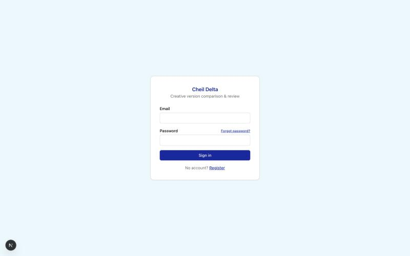
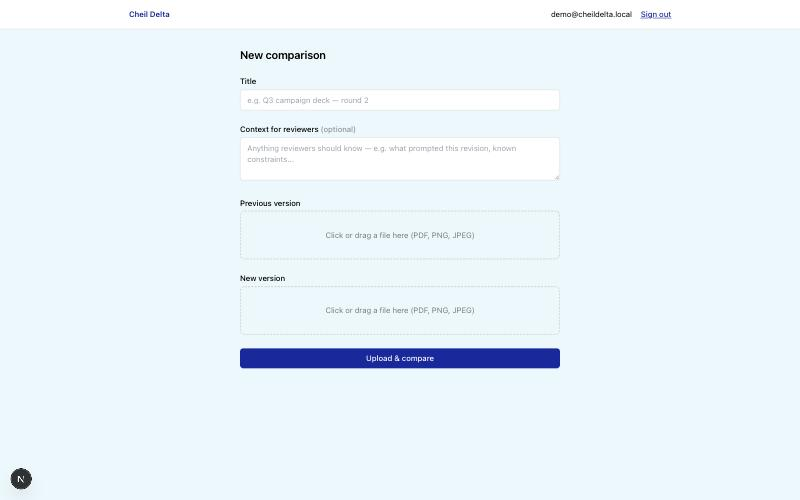
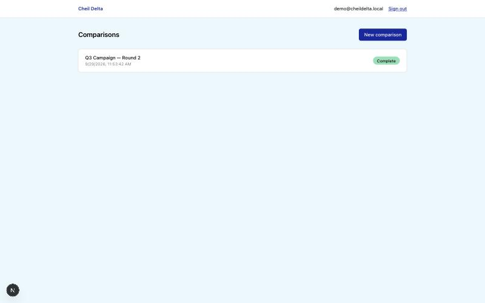
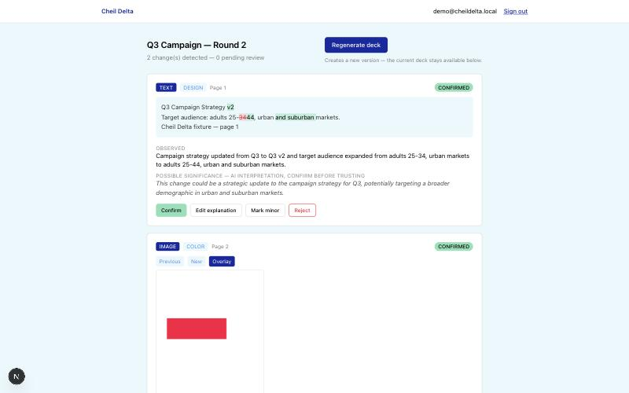
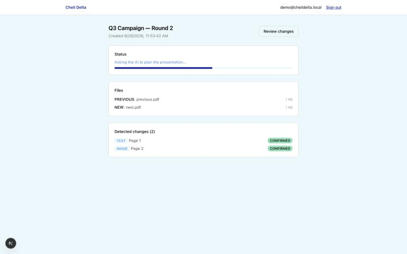
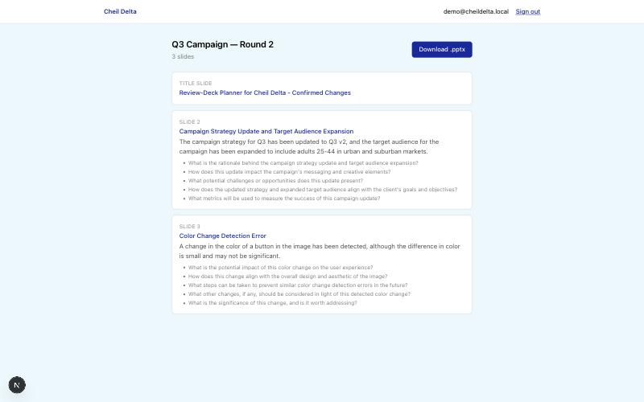

# Cheil Delta

Cheil Delta compares two versions of a creative/marketing file (PDF or image), detects what
changed using deterministic diffing, has an AI pipeline explain the changes in plain language,
and — after a human reviews and confirms every change — generates a PowerPoint review deck.

The AI never generates the presentation directly, never invents changes on its own, and never
gets treated as approved until a human confirms it. See [docs/known-gaps.md](docs/known-gaps.md)
for what's simplified in this build versus a full enterprise deployment, and why.

## Screenshots

All screens below are real captures from a running instance, not mockups.

| | |
|---|---|
|  Sign in — email/password auth with self-service password reset |  Upload two versions of a file to compare |
|  Dashboard — every comparison at a glance |  Review — AI-flagged changes, confirmed or corrected by a human before anything ships |
|  Live progress — a real percentage-based bar while the AI works |  Generated deck — branded, versioned, ready to present |

## How it works

```
Upload previous + new file (browser)
      -> Deterministic diff pipeline (PDF render, text extract, OCR fallback, text/image diff)
      -> AI pipeline: Classifier -> Explainer -> Relationship Mapper (stages 1-3, automatic)
      -> Human review: confirm / edit / reject / mark minor every detected change
      -> AI pipeline: Review-Deck Planner (stage 4, only runs post-approval)
      -> Deterministic .pptx generation
      -> Download
```

All of the above (diffing + all 4 AI stages + deck generation) runs as background jobs via
graphile-worker, with the UI polling for status.

## Prerequisites

- Node.js 20+
- PostgreSQL 16+ (local via Docker, or any reachable instance)

## Setup

```bash
cp .env.example .env
```

Fill in `.env`:
- `DATABASE_URL` — defaults to the docker-compose Postgres below
- `AUTH_SECRET` — generate with `npx auth secret`
- `ENCRYPTION_KEY` — generate with `openssl rand -hex 32` (optional but recommended; without it, uploaded files are stored unencrypted at rest)
- `AI_PROVIDER=mock` to run fully offline with no API key, `AI_PROVIDER=openai` / `AI_PROVIDER=anthropic` + `AI_API_KEY` for real paid AI calls, `AI_PROVIDER=ollama` for a free local model (requires `ollama serve` running and a vision model pulled, e.g. `ollama pull llava`; no key needed), or `AI_PROVIDER=fallback` to chain providers and fail over to the next one if a call errors (e.g. `AI_FALLBACK_ORDER=anthropic,openai` with `ANTHROPIC_API_KEY` and `OPENAI_API_KEY` both set). Mock has no real image understanding — use one of the others if you need the AI to actually interpret image content (e.g. to catch a visual element that's present in one version and missing in the other, not just moved or recolored). Of the non-mock options, `ollama` is free but noticeably less reliable — see [docs/known-gaps.md](docs/known-gaps.md) for specifics

Start Postgres:

```bash
docker compose up -d
```

Install dependencies and set up the database:

```bash
npm install
npm run db:migrate
```

Run the app and the background worker (two processes):

```bash
npm run dev      # Next.js app on http://localhost:3000
npm run worker   # graphile-worker — required for uploads to actually process
```

Register the first account at `/register` — it's automatically granted the `ADMIN` role.

## Project structure

- `src/app/` — Next.js App Router pages and API routes
- `src/lib/diff/` — deterministic PDF rendering, text extraction, OCR fallback, text/image diffing
- `src/lib/ai/` — the 4-stage AI pipeline: schemas (`schemas/`), stage implementations (`stages/`),
  the orchestrator (`pipeline-orchestrator.ts`), the provider abstraction (`provider.ts`,
  `providers/`), and the scoped, read-only context-building functions in `tools/`
- `src/lib/deck/` — deterministic `.pptx` generation from the AI's approved slide plan
- `src/lib/jobs/` — graphile-worker task definitions and the worker entry point
- `src/lib/storage/` — local-disk storage adapter with optional AES-256-GCM encryption at rest
- `prisma/schema.prisma` — full data model

## Scripts

| Command | Purpose |
|---|---|
| `npm run dev` | Start the Next.js dev server |
| `npm run worker` | Start the background job worker (required — uploads won't process without it) |
| `npm run build` / `npm start` | Production build and start |
| `npm run typecheck` | `tsc --noEmit` |
| `npm run lint` | ESLint |
| `npm run db:migrate` | Apply Prisma migrations (dev) |
| `npm run db:studio` | Open Prisma Studio |
| `npm run seed:fixtures` | Generate two small fixture PDFs into `fixtures/` for manual testing |

## Testing the whole flow locally

```bash
npm run seed:fixtures
```

Then, signed in, create a new comparison and upload `fixtures/previous.pdf` as the previous
version and `fixtures/next.pdf` as the new version. With `AI_PROVIDER=mock` (the default) this
requires no API key and produces deterministic, context-aware fake explanations — real text and
image diffs, fake AI judgment — so the whole pipeline is testable offline.

## Deploying (free, no payment method required)

This path runs on Vercel's free Hobby tier + a free-tier Postgres provider + this repo's own
GitHub Actions cron as a catch-up sweep — no card on file anywhere. See
[docs/known-gaps.md](docs/known-gaps.md) for how this actually works (there's no long-running
worker process on this path) and its real limitations (serverless time limits, ephemeral file
storage). If you'd rather run a real always-on worker process (more robust, but the platforms that
support it — Railway, Render, Fly.io — now require a payment method even for free-tier usage), skip
this section and deploy `npm run build && npm start` plus `npm run worker` there instead.

1. **Database**: create a free Postgres instance on [Supabase](https://supabase.com) or
   [Neon](https://neon.tech) (no card required for either's free tier). Copy the connection string.
2. **Deploy the app**: import this GitHub repo into [Vercel](https://vercel.com) (free, sign in
   with GitHub, no card required for Hobby). Set these environment variables in the Vercel project
   settings:
   - `DATABASE_URL` — from step 1
   - `AUTH_SECRET` — generate with `npx auth secret`
   - `ENCRYPTION_KEY` — generate with `openssl rand -hex 32`
   - `CRON_SECRET` — any random string; you'll reuse it in step 3
   - `AI_PROVIDER=mock` (recommended for this path — see known-gaps.md for why a real provider is
     riskier here specifically)
   - `APP_URL` — your Vercel deployment URL (fill in after the first deploy, e.g.
     `https://your-project.vercel.app`)
3. **Run migrations against the new database** (one-time, from your machine, pointed at the
   deployed `DATABASE_URL`):
   ```bash
   DATABASE_URL="<your-supabase-or-neon-url>" npx prisma migrate deploy
   ```
4. **Enable the catch-up cron**: in the GitHub repo, go to Settings → Secrets and variables →
   Actions, and add two repository secrets:
   - `APP_URL` — same value as step 2
   - `CRON_SECRET` — same value as step 2

   `.github/workflows/process-jobs-cron.yml` will start hitting `/api/cron/process-jobs` every ~5
   minutes automatically — this is only a safety net (see known-gaps.md); most jobs are picked up
   immediately without waiting for it.
5. Register the first account at `/register` on your deployed URL — it's automatically granted
   `ADMIN`, same as local dev.

## Known gaps

This is a from-scratch build made to run standalone (no cloud storage account, no enterprise SSO,
no provisioned hosting). See [docs/known-gaps.md](docs/known-gaps.md) for the full list of what's
simplified versus a full production deployment, and what a real launch still needs.
